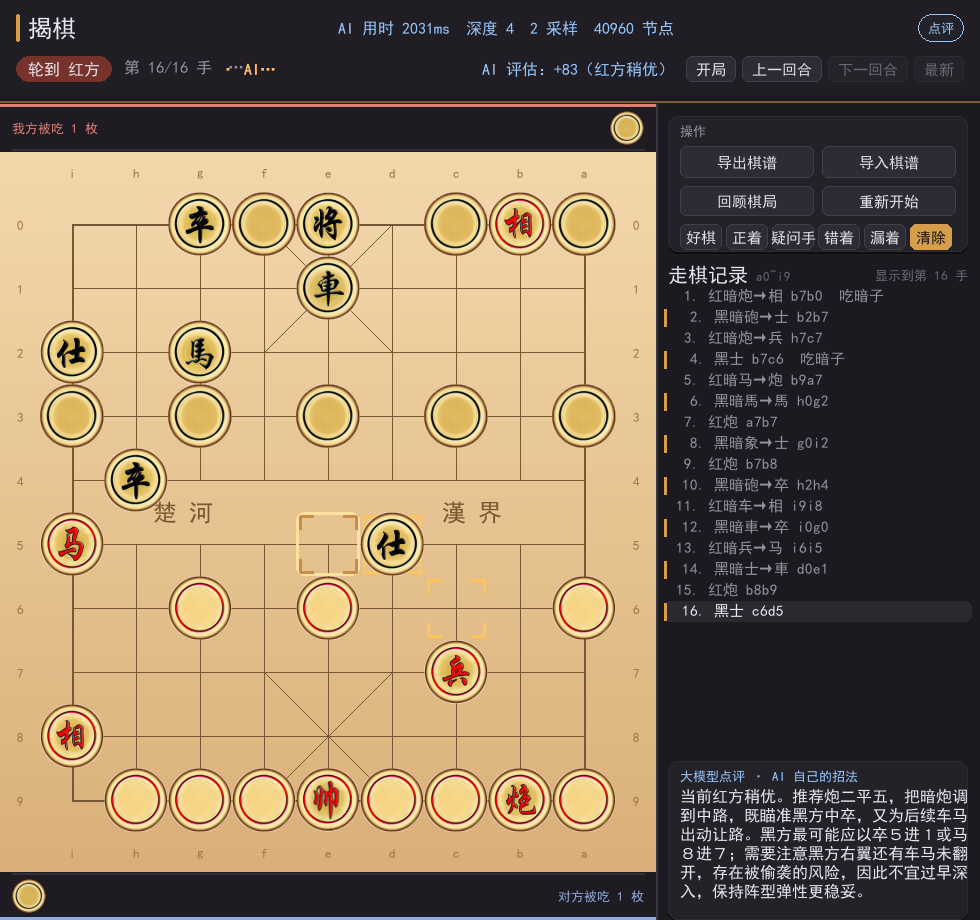

# 揭棋 AI（Jieqi / 暗棋象棋）

一个用 Python + pygame 写的**揭棋**对局程序，带一个**不完全信息博弈**搜索引擎、
可选的大模型顾问、完整的棋谱与复盘功能。

棋子开局全部背面朝上（"暗子"），走到哪一格就在那里翻开——**双方都看不到对方
暗子的真实身份**（连执子方自己也只知道自己翻开了什么）。所以这不是普通象棋引擎
套个皮肤：搜索必须在"信息不完全"的前提下做决策。



---

## 目录

- [特性](#特性)
- [快速开始](#快速开始)
- [操作方式](#操作方式)
- [AI 引擎](#ai-引擎)
- [大模型顾问（可选）](#大模型顾问可选)
- [棋谱与复盘](#棋谱与复盘)
- [配置文件](#配置文件)
- [项目结构](#项目结构)
- [开发与测试](#开发与测试)
- [常见问题](#常见问题)
- [许可](#许可)

---

## 特性

| 方面 | 说明 |
|---|---|
| **对局方式** | 红、黑两方**各自**可以选「人工输入 / 本机引擎 / 大模型」，边下边按 `E`、`T` 随时切换 |
| **本机引擎** | Negamax + Alpha-Beta + PVS、置换表、杀手着法、历史启发、静态搜索、空着裁剪、将军延伸 |
| **不完全信息** | 对暗子身份做**定局化采样**（determinization）后搜索，跨采样做评估聚合；`samples` 可调 |
| **揭棋规则** | 暗子走法与翻开规则、长将 / 长捉判负（按参与棋子数 6/12/18 回合）、200 手判和 |
| **大模型顾问** | 可选，兼容任何 OpenAI 风格接口；支持"只点评"和"完全采用它的招法"两种参与程度 |
| **棋谱** | 自动保存（JSON + 可读 TXT）、逐步自由切换、人工打分、导出训练样本 JSONL |
| **复盘** | 翻手浏览、失着分析（`record_tool.py analyse`）、被吃棋子展示、局面评估曲线 |
| **界面** | 三区布局（棋盘 / 操作卡 / 走棋记录），棋盘外围 `a`~`i`、`0`~`9` 坐标，中文棋子图 |
| **测试** | 485 个单元测试，覆盖规则、引擎、界面几何、棋谱往返 |

---

## 快速开始

需要 **Python 3.9+**（开发用的是 3.13）和 **pygame**。唯一的外部依赖就是 pygame。

```bash
git clone https://github.com/<你的用户名>/<仓库名>.git
cd <仓库名>
pip install -r requirements.txt
```

然后运行（两种方式都可以）：

```bash
python stage/Game/main.py      # 从仓库根目录
```

或者：

```bash
cd stage/Game
python main.py                 # 进入代码目录
```

> 首次运行会在 `stage/Game/` 下自动创建 `records/` 目录用来存棋谱。
> 棋子图片按 `resource_manager.py` 自身的位置定位，所以**在哪个目录运行都可以**。

---

## 操作方式

### 通用

| 按键 | 作用 |
|---|---|
| 鼠标左键 | 选子 / 落子；点击界面按钮 |
| `ESC` | 回启动页（改设置 / 换对局方式 / 继续上一局） |
| `F2` | 人机 / 双人对战切换 |
| `1` `2` `3` `4` | 难度：简单 / 普通 / 困难 / 专家 |
| `5` `6` `7` `8` `9` | 给当前这手人工打分：好棋 / 正着 / 疑问手 / 错着 / 漏着 |
| `0` | 清除当前这手的打分 |
| `5` `6` `7` `8` `9` `0`（同上） | 打分结果会写进棋谱，可导出成训练权重 |

### 对局中

| 按键 | 作用 |
|---|---|
| `E` | 切换**红方**的对局方式（人工 → 本机引擎 → 大模型） |
| `T` | 切换**黑方**的对局方式 |
| `C` | 换边（我执红 / 我执黑） |
| `L` | 打开 / 关闭大模型点评 |
| `K` | 打开 / 关闭大模型"应用招法" |
| `S` | 手动保存棋谱 |
| `I` | 导入棋谱 |
| `V` | 「回顾棋局」浮层（大棋盘 + 被吃之子） |
| `M` | 回启动页 |
| `←` `→` | 上一手 / 下一手 |
| `Home` `End` | 跳到开局 / 最新 |

> 浏览历史（按 `←`）时 AI **不会**替你走子，这是刻意的：否则你一翻手它就抢着落子。

---

## AI 引擎

### 搜索

主搜索在 `stage/Game/jieqi/search.py`，用 Negamax + Alpha-Beta，配合：

- **PVS**（主变例搜索）
- **置换表**（Zobrist 哈希）
- **杀手着法 + 历史启发**（着法排序）
- **静态搜索**（quiescence）——避免"吃了再看"的 horizon 效应
- **空着裁剪**、**将军延伸**
- **迭代加深 + 时间控制**（`time_limit` 秒预算）

### 不完全信息怎么处理

这是揭棋和普通象棋最大的区别。做法是**定局化（determinization）采样**：

1. 按"信念状态"（`jieqi/belief.py`）随机给所有暗子分配一个具体身份，得到一个
   **完全信息**的局面；
2. 在这个局面上正常搜索；
3. 重复 `samples` 次，对结果做聚合（可以带方差惩罚，见 `variance_penalty`）。

之所以默认 `samples=1`：实测（32 局同时间自对弈 A/B）`samples=1` 对
`samples=2` 胜率 77%，而两者实际搜索深度几乎相同（3.5 vs 3.4）——时间被分摊到
两次独立定局化上并不会搜得更深，而"跨不同世界取平均"会稀释只在部分世界成立的
战术。想让 AI 更保守，可以调大 `samples` 并打开 `variance_penalty`。

> 引擎**默认不使用**被吃暗子的真实身份（`use_hidden_captures: false`），
> 以保证 AI 与人类信息对称。改成 `true` 会让 AI 占便宜。

### 难度预设

| 难度 | 键 | 每步时间 | 采样 | 最大深度 | 静态搜索 | 空着裁剪 | 方差惩罚 |
|---|---|---|---|---|---|---|---|
| 简单 | `1` | 0.5 s | 1 | 2 | ✗ | ✗ | 0 |
| 普通 | `2` | 2.0 s | 2 | 64 | ✓ | ✓ | 0 |
| 困难 | `3` | 5.0 s | 4 | 64 | ✓ | ✓ | 0.15 |
| 专家 | `4` | 10.0 s | 6 | 64 | ✓ | ✓ | 0.25 |

（"简单"还带 `temperature=90` 的随机性，避免每一步都走同一条线。）

### 规则实现

`stage/Game/jieqi/rules.py` 实现了揭棋特有的判罚（依据棋者象棋《揭棋玩法规则》）：

- **长将禁招**：按参与将军的不同棋子数，上限 6 / 12 / 18 回合；
- **长捉禁招**：单子 6 回合、双子 12 回合；兵（卒）、帅（将）、士（仕）、象（相）可以长捉；
- 同一枚棋子不能连续长将 / 长捉超过 6 次；
- **200 手判和**。

---

## 大模型顾问（可选）

在 `stage/Game/ai_config.json` 的 `llm` 段填上 `api_key`（或用环境变量
`OPENAI_API_KEY`），把 `enabled` 改成 `true` 即可。任何 **OpenAI 风格**的接口都能用
（改 `base_url` + `model` 即可，例如 DeepSeek、通义、本地 vLLM）。

三种参与程度：

| 模式 | 行为 |
|---|---|
| `explain` | **只点评**，不影响选着（`blend_weight=0`） |
| 应用招法 | **完全采用**大模型给的招法（按 `K` 打开） |
| 混合 | `blend_weight > 0` 时把大模型的评估与引擎评估加权 |

安全网（这些不是可选项，是默认开着的）：

- 大模型给的着法**必须合法**才会被采用，否则退回本机引擎并写明原因；
- **点评归属质检**（`comment_validation`）：发现模型把红黑 / 明暗说反时自动改判，
  改不了就定向重问一次——关掉等于放任幻觉。

示例配置见 `stage/Game/ai_config.llm.example.json`。

---

## 棋谱与复盘

对局结束会自动存到 `stage/Game/records/`（可在配置里关掉）。每局两个文件：

- `*.json` —— 完整数据（着法、评估、点评、人工打分、用时）
- `*.txt` —— 给人看的可读棋谱

命令行工具 `record_tool.py`：

```bash
cd stage/Game

python record_tool.py list                       # 列出全部棋谱
python record_tool.py show <名字>                 # 看某一局
python record_tool.py text <名字> --board 30      # 到第 30 手为止的棋盘
python record_tool.py analyse <名字> --time 0.8   # 逐手复查找失着
python record_tool.py train --all -o training.jsonl   # 导出训练样本
```

> `--dir` 是**全局**选项，要放在子命令前面：
> `python record_tool.py --dir ../my_records list`

---

## 配置文件

`stage/Game/ai_config.json`（首次运行前可以不存在，缺省时用内置默认值）：

```jsonc
{
  "ai": {
    "difficulty": "normal",       // easy / normal / hard / expert
    "time_limit": 2.0,            // 每步思考秒数；null = 用难度预设
    "samples": 1,                 // 暗子身份采样个数
    "max_depth": null,            // null = 不限（用难度预设）
    "use_hidden_captures": false, // 是否偷看被吃暗子的真实身份（默认关）
    "reveal_weights": {},         // 翻子搜索加成（默认空，未验证的权重不启用）
    "weights": {}                 // 覆盖评估权重，如 {"hanging": 0.35}
  },
  "record": { "auto_save": true },
  "llm": {
    "enabled": false,
    "base_url": "https://api.openai.com/v1",
    "api_key": "",                // ⚠ 填了真 key 就不要提交这个文件
    "model": "gpt-4o-mini"
  }
}
```

> **安全提醒**：`ai_config.json` 里会放 API Key。仓库里这一份的 `key` 是空的，
> 如果你在本地填了真 key，**提交前确认它没被 `git add`**：
> `git status` 看它是否出现在待提交列表里。更稳妥的做法是用环境变量
> `OPENAI_API_KEY`，完全不往文件里写 key。

---

## 项目结构

```
.
├── LICENSE
├── README.md
├── requirements.txt
├── .gitignore
├── deploy.py                 # 把代码从开发目录同步到"游戏目录"的部署脚本
├── docs/                     # README 用截图
├── stage/                    # ← 代码都在这里
│   ├── Game/                 # 游戏本体
│   │   ├── main.py           # 入口（主循环 / 事件分发）
│   │   ├── AI.py             # 控制器：把"这一方谁来走"接到具体引擎
│   │   ├── game_state.py     # 局面状态：着法、历史、棋谱、打分
│   │   ├── renderer.py       # 全部绘制
│   │   ├── start_screen.py   # 启动页
│   │   ├── input_handler.py  # 键鼠事件 → 命令
│   │   ├── config.py         # 布局与配色令牌
│   │   ├── resource_manager.py  # 字体与棋子图
│   │   ├── images/           # 16 张棋子图
│   │   ├── jieqi/            # ← 引擎与规则（可独立 import，无 pygame 依赖）
│   │   │   ├── board.py      # 棋盘表示与着法生成
│   │   │   ├── search.py     # Negamax / Alpha-Beta / 置换表
│   │   │   ├── engine.py     # 对外接口 + 难度预设 + 时间控制
│   │   │   ├── evaluate.py   # 局面评估
│   │   │   ├── belief.py     # 暗子身份的信念状态
│   │   │   ├── reveal.py     # 翻子搜索加成
│   │   │   ├── rules.py      # 长将 / 长捉 / 判和
│   │   │   ├── notation.py   # 坐标记法（唯一真相来源）
│   │   │   ├── record.py     # 棋谱读写
│   │   │   ├── engines.py    # 对局方式的档位定义
│   │   │   ├── llm.py        # 大模型客户端
│   │   │   └── settings.py   # 配置读取
│   │   └── ai_config.json    # 配置文件
│   ├── tests/                # 485 个单元测试
│   └── tools/                # 自对弈 / 合法性审计 / 界面冒烟 / 预览图
└── _bench/                   # 开发期诊断与基准脚本
```

---

## 开发与测试

```bash
cd stage
python -m unittest discover -s tests -p "test_*.py"          # 全部（约 2 分钟）
python -m unittest discover -s tests -p "test_rules.py" -v   # 单个文件
```

其他工具（都在 `stage/tools/`，**无显示器也能跑**）：

```bash
python tools/gui_smoke.py        # 端到端冒烟：真开窗口走一遍全部界面流程
python tools/ui_preview.py       # 把各个界面渲染成 PNG 便于肉眼检查
python tools/legality_audit.py   # 用 GUI 规则复核 AI 的每一步（验证"从不送脏招"）
python tools/selfplay.py --help  # 自对弈 / 对抗，用于 A-B 测试改动
```

`_bench/check_publish_ready.py` 会在发布前扫一遍代码，确认没有写死的绝对路径、
没有跨目录依赖、没有明文凭据。

---

## 常见问题

**Q：启动报 `FileNotFoundError: images/red_king.png`？**
A：这是老版本的 bug（图片按相对路径找，必须 `cd` 到 `Game/` 才能跑）。
现在已修好，用最新代码即可。

**Q：AI 每一步都要想好几秒，能快点吗？**
A：在配置文件里调小 `ai.time_limit`，或按 `1` 切到"简单"。

**Q：中文显示成方块？**
A：程序按路径加载 Windows 自带中文字体（黑体 / 雅黑 / 宋体 / 等线）。
在非 Windows 系统上会退化到 pygame 内置字体（无中文）。装一个中文字体后，
改 `resource_manager.py` 里的 `_SIMHEI` / `_FALLBACKS` 路径即可。

**Q：为什么大模型不给我招法？**
A：检查三件事：`llm.enabled` 是否为 `true`、`api_key` 是否填了（或环境变量
`OPENAI_API_KEY`）、`base_url` / `model` 是否与你的服务商匹配。启动时控制台会
打印具体的失败原因。

---

## 许可

[MIT](LICENSE) —— 随便用，保留版权声明即可。

规则实现参考了棋者象棋《[揭棋玩法规则](https://qizhe.org.cn/home/?p=848)》；
翻子搜索加成的权重归一化口径借鉴了开源揭棋引擎 AB-JChess（GPL-3.0）的实现思路，
但那部分权重**默认为空且未启用**，本项目不包含其任何代码。
